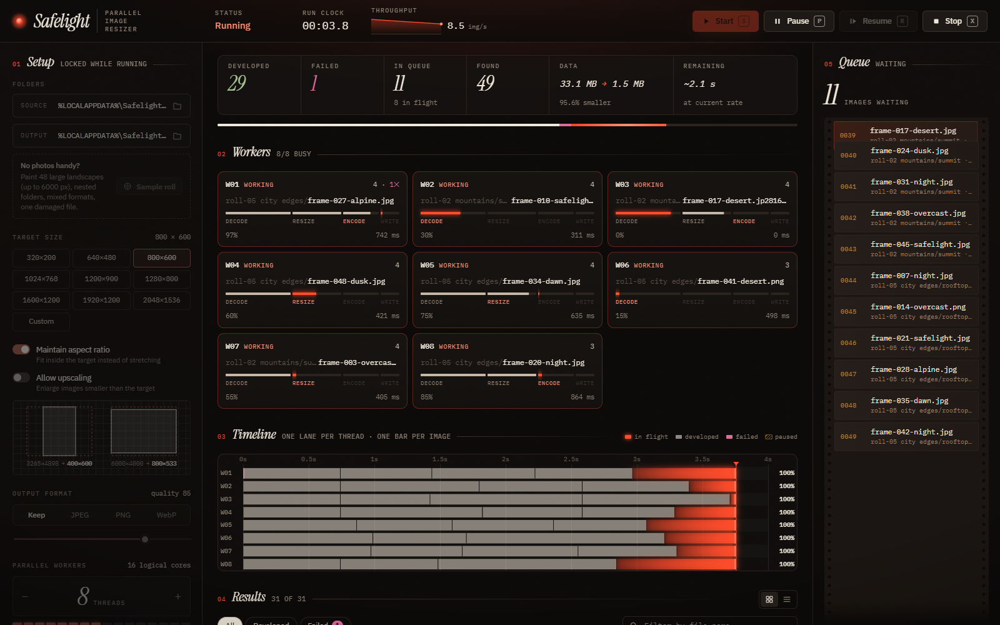
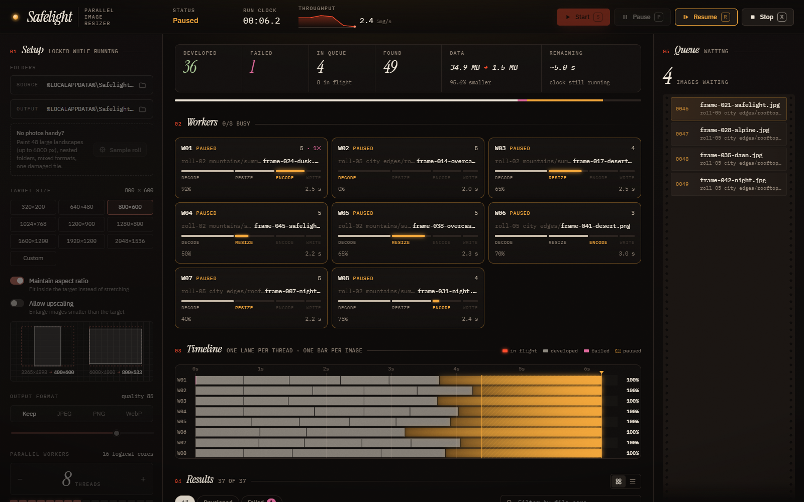
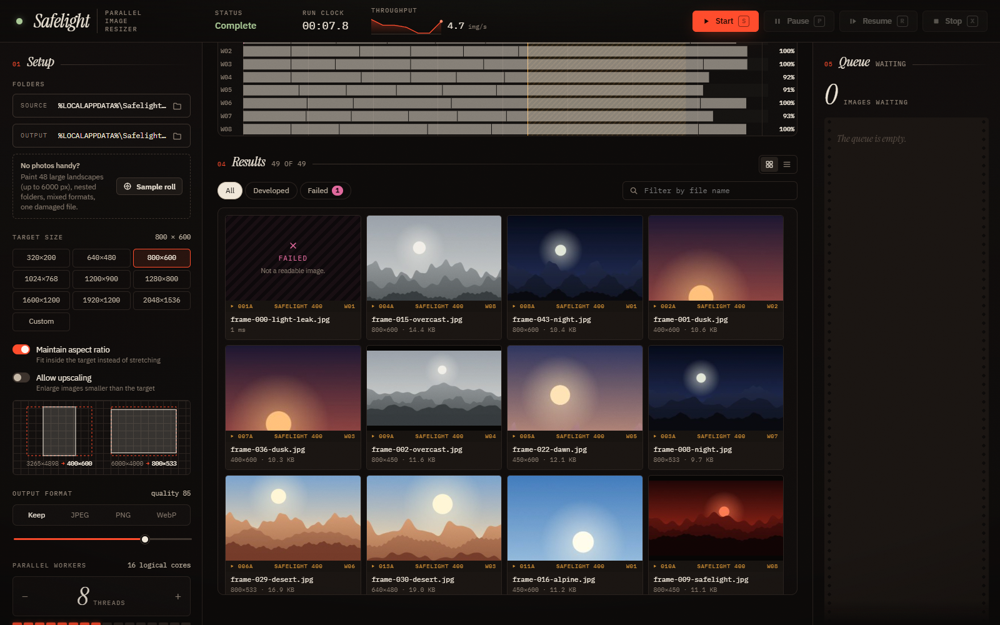
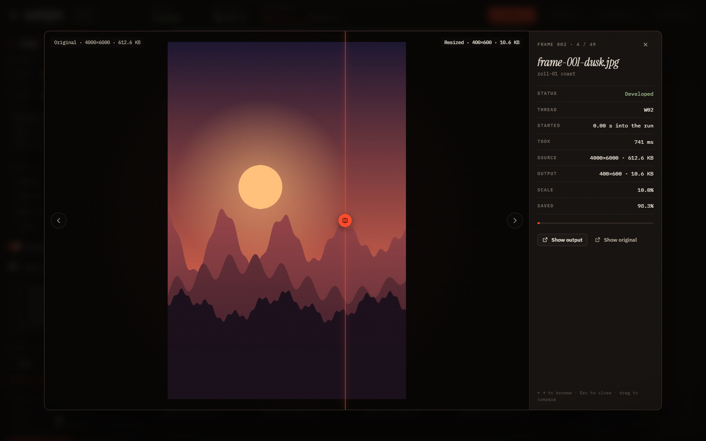
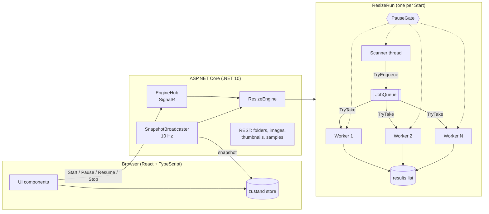

# Safelight

**A parallel bulk image resizer.** Final exam project for the *Concurrent Programming* course.

Safelight takes a folder of photos, walks every sub-folder, and resizes every image to a target size with a pool of worker threads that you can configure. The output folder mirrors the source structure. While it runs you can watch each thread work, pause and resume the whole pool, or stop it. Finished images appear in a contact sheet where you can compare each original with its resized version.



---

## One job

**One job = resize one image file.**

A job is created for every supported image found under the source folder (`.jpg .jpeg .png .webp .bmp .gif`). A worker that takes a job runs it through four stages:

| Stage | What happens |
|---|---|
| **Decode** | Read the file and decode the pixels. EXIF orientation is applied so phone photos come out upright. Large JPEGs are decoded at reduced scale when the target is much smaller. |
| **Resize** | Scale to the target size, proportionally or stretched (Mitchell cubic filter). |
| **Encode** | Encode to the original format, or to JPEG / PNG / WebP if one was chosen. |
| **Write** | Write to a temporary `.part` file, then rename it, so a Stop never leaves a half-written image. |

Every stage boundary is a **checkpoint** where the worker honours Pause and Stop.

## Features

- **Configurable parallel workers**: 1 to 64 real `Thread`s (the UI offers 1–32). The default is half the logical cores, up to 8.
- **Start / Pause / Resume / Stop** control all workers together. Keyboard shortcuts: `S` `P` `R` `X`, and `Space` toggles pause.
- **Producer–consumer pipeline**: a scanner thread walks the folder tree and feeds the queue while the workers are already consuming it.
- **Worker view**: one card per thread showing its current file, live stage progress, time on the current job and how many jobs it has finished.
- **Timeline**: a swimlane chart with one lane per thread and one bar per image. Pauses appear as hatched bands, and each lane shows its utilisation. Hover a bar for details or click it to open the image.
- **Queue view**: the waiting jobs, styled as a film strip. Frames slide out as workers take them.
- **Results**: a virtualized **contact sheet** (thumbnails "develop" in as jobs finish) and a **ledger** table. Both can be filtered by outcome and searched by name.
- **Comparison viewer**: a draggable before/after slider with dimensions, size saved, thread and timing. Arrow keys move between images, and "Show in Explorer" opens the file.
- **Proportional sizing** with a live diagram. The example from the assignment, 3265×4898 into 800×600, gives **400×600**. "Maintain aspect ratio" and "Allow upscaling" are toggles, and all the preset sizes from the brief are available, plus Custom.
- **Sample roll generator**: paints 48 large (up to 6000 px) landscapes in parallel, across nested folders, in mixed formats, plus one deliberately corrupt file. You can try the app without your own photos.
- **Simulated latency** slider: slows every job so the interleaving of threads is easy to watch on a fast machine.
- **Folder browser**: browsers can't give a page a real local path, so the server lists the file system and the UI navigates it.
- **The UI never freezes.** See [Keeping the UI responsive](#keeping-the-ui-responsive).

| Paused | Contact sheet | Before / after |
|---|---|---|
|  |  |  |

## Architecture



| Project | Responsibility |
|---|---|
| [`src/Safelight.Core`](src/Safelight.Core) | All concurrency and imaging. No web dependencies, so it can be tested on its own. |
| [`src/Safelight.Server`](src/Safelight.Server) | ASP.NET Core host: SignalR hub, snapshot broadcaster, REST endpoints, and it serves the built UI. |
| [`client`](client) | React 19 + TypeScript + Vite UI. Animations use `motion`; long lists use `@tanstack/react-virtual`. |
| [`tests/Safelight.Core.Tests`](tests/Safelight.Core.Tests) | xUnit tests for the queue, pause gate, path registry, sizing and the full engine lifecycle. |

Images are processed with **SkiaSharp** (MIT). ImageSharp was considered, but its v4 requires a commercial key for Release builds and its v3 has open CVEs.

## Shared data and how it is protected

Each piece of shared state has exactly one guard.

| Shared data | Who touches it | Protection |
|---|---|---|
| **Job queue** ([`JobQueue<T>`](src/Safelight.Core/Concurrency/JobQueue.cs)) | Scanner adds; N workers take; Stop drains; UI peeks | A `Lock` around the `Queue<T>` plus a `SemaphoreSlim` that counts available items. Workers block on the semaphore, never while holding the lock. |
| **Results list** | Workers append; the broadcaster reads pages | Its own `Lock` (`_resultsLock`). |
| **Run status, pause intervals, finish time** | Control commands; the last exiting worker | `_stateLock` in [`ResizeRun`](src/Safelight.Core/Engine/ResizeRun.cs). |
| **Per-worker status** (job, stage, progress) | Written by its own worker; read by the broadcaster | A `Lock` per [`WorkerSlot`](src/Safelight.Core/Engine/WorkerSlot.cs), so the UI never sees a torn state such as a new file name with the old job's 100%. |
| **Counters** (found, succeeded, failed, bytes) | All workers | `Interlocked.Increment` / `Interlocked.Add`. They are independent numbers, so no lock is needed. |
| **Output file names** ([`OutputPathRegistry`](src/Safelight.Core/Concurrency/OutputPathRegistry.cs)) | All workers | A `Lock` + `HashSet`: claiming a path is one atomic step. |
| **Pause state** ([`PauseGate`](src/Safelight.Core/Concurrency/PauseGate.cs)) | Control commands; every checkpoint | `ManualResetEventSlim`: `Reset` pauses everyone, `Set` releases everyone at once. |
| **Stop** | Control command; every checkpoint and every blocking wait | `CancellationTokenSource`. Every wait takes the token, so Stop wins over Pause. |
| **Thumbnail rendering** | Concurrent HTTP requests | A `SemaphoreSlim` caps parallel renders so previews never starve the resize workers. A double-checked cache lookup stops two requests rendering the same image. |

### Where race conditions could appear

- **Two workers writing the same output file.** `cat.png` and `cat.jpg` both become `cat.jpg` when the output format is JPEG. "Check if it exists, then write" is a check-then-act race. → `OutputPathRegistry.Claim` checks and reserves under one lock, and the second file becomes `cat (2).jpg`. A test fires 200 parallel claims at the same path.
- **Lost or duplicated jobs.** Two workers dequeuing at once from an unprotected `Queue<T>` can corrupt it or take the same item twice. → Every queue operation is under the lock. A test runs 4 producers × 5000 items against 8 consumers and checks that every item arrives exactly once.
- **Lost counter updates.** `succeeded++` from many threads is a read-modify-write race. → `Interlocked`.
- **Pause racing with "finished".** The last worker can finish at the same moment the user presses Stop. → Both transitions run under `_stateLock`, so whichever arrives second sees the other's result (`Stopped` or `Completed`, never both).
- **Torn UI state.** The UI could read a worker's job and progress halfway through an update. → Each slot is snapshotted under its own lock.

### Where deadlocks could appear, and why they don't

- **Waiting while holding a lock.** If a worker held the queue lock while waiting for an item, the scanner could never add one. → Workers wait on the semaphore *before* taking the lock.
- **Lock ordering.** Two threads taking locks A→B and B→A deadlock. → No code path holds two run locks at once. The only nesting is engine `_controlLock` → run lock, always in that order and never reversed (documented in [`ResizeEngine`](src/Safelight.Core/Engine/ResizeEngine.cs)).
- **Workers parked forever.** A paused worker or one blocked on an empty queue must still wake on Stop. → Every blocking wait (`SemaphoreSlim.Wait`, `ManualResetEventSlim.Wait`, latency sleeps) takes the cancellation token.
- **Missed completion signal.** When the queue runs dry, *all* waiting workers must wake, not just one. → A woken worker that finds the queue empty and completed passes the signal on, so it cascades to the others.
- **Shutdown race.** On Stop the workers can exit while the scanner is still inside a slow directory listing. → The last worker joins the scanner before the run counts as finished, and the engine only disposes a run once all its threads have exited.

## Keeping the UI responsive

- Workers never talk to the browser directly. A background service samples the engine **10 times a second** and pushes one snapshot over SignalR. UI work stays bounded however many threads run or however fast they finish.
- Finished jobs are sent as **deltas** from a cursor, so each one crosses the wire once.
- The timeline is drawn on a **canvas** in a `requestAnimationFrame` loop that reads the store directly: thousands of bars, no React re-renders per frame.
- The contact sheet and ledger are **virtualized**: only visible rows exist in the DOM.
- Thumbnails are rendered on the server in parallel (capped) and cached.

## Running it

Requirements: **.NET 10 SDK** and **Node.js 22+**.

```bash
# 1. build the UI into the server's wwwroot
cd client
npm install
npm run build

# 2. run the server (opens http://localhost:5080)
cd ..
dotnet run --project src/Safelight.Server
```

Then click **Sample roll** (or choose your own source folder), and press **Start**.

For UI development with hot reload, keep the server running and start Vite in another terminal (`cd client && npm run dev`, then open http://localhost:5173). It proxies `/api` and `/hub` to the server.

### Tests

```bash
dotnet test
```

17 tests cover sizing (including the 3265×4898 → 400×600 case from the brief), exactly-once delivery under contention, drain/cancel wake-ups, path claiming, the pause gate, and end-to-end runs: complete, pause-freezes-progress, stop-cancels-and-cleans-up, double start rejected, and output-inside-source rejected.

## Project structure

```
Safelight.sln
├── src/
│   ├── Safelight.Core/
│   │   ├── Concurrency/   JobQueue, PauseGate, OutputPathRegistry
│   │   ├── Engine/        ResizeEngine, ResizeRun, WorkerSlot, snapshots
│   │   └── Imaging/       ImageProcessor, SizeCalculator, SampleRollGenerator
│   └── Safelight.Server/  Program, EngineHub, SnapshotBroadcaster, endpoints
├── tests/Safelight.Core.Tests/
└── client/                React + TypeScript UI
```

## License

GPL-3.0. See [LICENSE](LICENSE).
